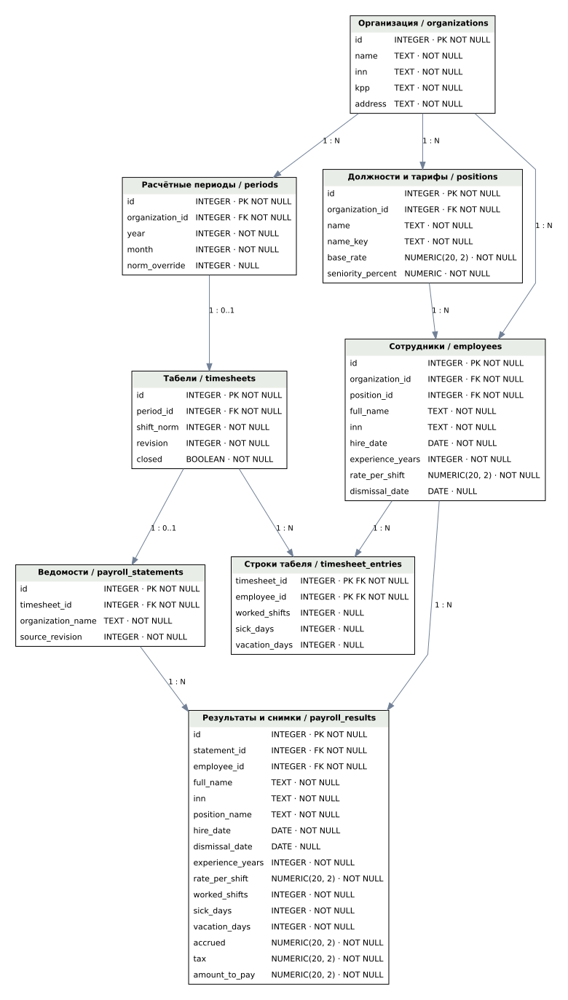
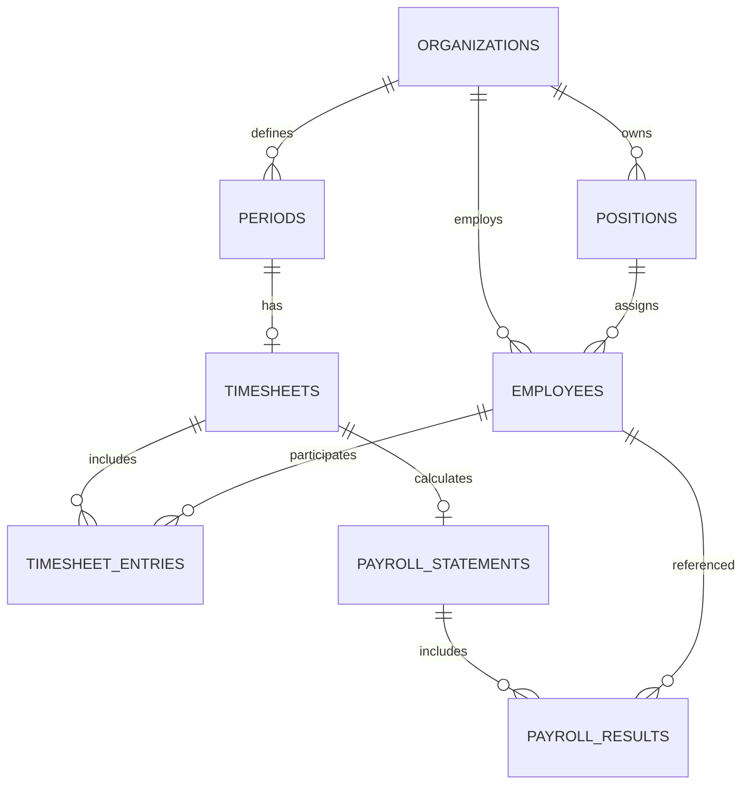

# ER-схема Salary Calculator — лабораторная работа 4

Исходник диаграммы: ER.dot. Таблицы реализованы в src/salary_calculator/db/models/. Схема рассчитана на одну настраиваемую организацию на установку; это не multi-tenant сервис.

## Связи

Сотрудники ↔ табели — many-to-many через timesheet_entries. Запись выполняется через association object TimesheetEntryRow. Двусторонние TimesheetRow.employees / EmployeeRow.timesheets используют secondary и viewonly=True: они не создают конкурирующий путь записи. Обе пары отношений используют back_populates.

## Поля и ограничения (точное соответствие ORM)

### Организация — organizations

| Поле | Тип | Ограничения |
| --- | --- | --- |
| id | INTEGER | PK, NOT NULL |
| name | TEXT | NOT NULL |
| inn | TEXT | NOT NULL |
| kpp | TEXT | NOT NULL |
| address | TEXT | NOT NULL |

- `ck_organizations_address_required`: `length(trim(address)) > 0`.
- `ck_organizations_individual_kpp`: `length(inn) != 12 OR kpp = ''`.
- `ck_organizations_inn_format`: `length(inn) IN (10, 12) AND length(replace(replace(replace(replace(replace(replace(replace(replace(replace(replace(inn, '0', ''), '1', ''), '2', ''), '3', ''), '4', ''), '5', ''), '6', ''), '7', ''), '8', ''), '9', '')) = 0`.
- `ck_organizations_kpp_format`: `kpp = '' OR (length(kpp) = 9 AND length(replace(replace(replace(replace(replace(replace(replace(replace(replace(replace(kpp, '0', ''), '1', ''), '2', ''), '3', ''), '4', ''), '5', ''), '6', ''), '7', ''), '8', ''), '9', '')) = 0)`.
- `ck_organizations_name_required`: `length(trim(name)) > 0`.
- `ck_organizations_single_organization`: `id = 1`.
- `uq_organizations_inn`: UNIQUE (inn).

### Расчётные периоды — periods

| Поле | Тип | Ограничения |
| --- | --- | --- |
| id | INTEGER | PK, NOT NULL |
| organization_id | INTEGER | NOT NULL, FK → organizations.id |
| year | INTEGER | NOT NULL |
| month | INTEGER | NOT NULL |
| norm_override | INTEGER | NULL допустим |

- `ck_periods_month_range`: `month BETWEEN 1 AND 12`.
- `ck_periods_norm_range`: `norm_override IS NULL OR norm_override BETWEEN 1 AND 31`.
- `ck_periods_year_range`: `year BETWEEN 1 AND 9999`.
- `uq_periods_organization_id`: UNIQUE (organization_id, year, month).

### Должности и тарифы — positions

| Поле | Тип | Ограничения |
| --- | --- | --- |
| id | INTEGER | PK, NOT NULL |
| organization_id | INTEGER | NOT NULL, FK → organizations.id |
| name | TEXT | NOT NULL |
| name_key | TEXT | NOT NULL |
| base_rate | NUMERIC(20, 2) | NOT NULL |
| seniority_percent | NUMERIC | NOT NULL |

- `ck_positions_name_required`: `length(trim(name)) > 0 AND length(name_key) > 0`.
- `ck_positions_premium_range`: `seniority_percent >= 0 AND seniority_percent <= 100`.
- `ck_positions_rate_range`: `base_rate > 0 AND base_rate <= 1000000000`.
- `uq_positions_organization_id`: UNIQUE (organization_id, name_key).

### Сотрудники — employees

| Поле | Тип | Ограничения |
| --- | --- | --- |
| id | INTEGER | PK, NOT NULL |
| organization_id | INTEGER | NOT NULL, FK → organizations.id |
| position_id | INTEGER | NOT NULL, FK → positions.id |
| full_name | TEXT | NOT NULL |
| inn | TEXT | NOT NULL |
| hire_date | DATE | NOT NULL |
| experience_years | INTEGER | NOT NULL |
| rate_per_shift | NUMERIC(20, 2) | NOT NULL |
| dismissal_date | DATE | NULL допустим |

- `ck_employees_date_order`: `dismissal_date IS NULL OR dismissal_date >= hire_date`.
- `ck_employees_experience_range`: `experience_years BETWEEN 0 AND 80`.
- `ck_employees_inn_format`: `length(inn) = 12 AND length(replace(replace(replace(replace(replace(replace(replace(replace(replace(replace(inn, '0', ''), '1', ''), '2', ''), '3', ''), '4', ''), '5', ''), '6', ''), '7', ''), '8', ''), '9', '')) = 0`.
- `ck_employees_name_required`: `length(trim(full_name)) > 0`.
- `ck_employees_rate_positive`: `rate_per_shift > 0`.
- `uq_employees_organization_id`: UNIQUE (organization_id, inn).

### Табели — timesheets

| Поле | Тип | Ограничения |
| --- | --- | --- |
| id | INTEGER | PK, NOT NULL |
| period_id | INTEGER | NOT NULL, FK → periods.id |
| shift_norm | INTEGER | NOT NULL |
| revision | INTEGER | NOT NULL |
| closed | BOOLEAN | NOT NULL |

- `ck_timesheets_norm_range`: `shift_norm BETWEEN 1 AND 31`.
- `ck_timesheets_revision_nonnegative`: `revision >= 0`.
- `uq_timesheets_period_id`: UNIQUE (period_id).

### Ведомости — payroll_statements

| Поле | Тип | Ограничения |
| --- | --- | --- |
| id | INTEGER | PK, NOT NULL |
| timesheet_id | INTEGER | NOT NULL, FK → timesheets.id |
| organization_name | TEXT | NOT NULL |
| source_revision | INTEGER | NOT NULL |

- `ck_payroll_statements_revision_nonnegative`: `source_revision >= 0`.
- `uq_payroll_statements_timesheet_id`: UNIQUE (timesheet_id).

### Строки табеля — timesheet_entries

| Поле | Тип | Ограничения |
| --- | --- | --- |
| timesheet_id | INTEGER | PK, NOT NULL, FK → timesheets.id |
| employee_id | INTEGER | PK, NOT NULL, FK → employees.id |
| worked_shifts | INTEGER | NULL допустим |
| sick_days | INTEGER | NULL допустим |
| vacation_days | INTEGER | NULL допустим |

- `ck_timesheet_entries_entry_state`: `(worked_shifts IS NULL AND sick_days IS NULL AND vacation_days IS NULL) OR (worked_shifts IS NOT NULL AND sick_days IS NOT NULL AND vacation_days IS NOT NULL AND worked_shifts >= 0 AND sick_days >= 0 AND vacation_days >= 0)`.

### Результаты и снимки — payroll_results

| Поле | Тип | Ограничения |
| --- | --- | --- |
| id | INTEGER | PK, NOT NULL |
| statement_id | INTEGER | NOT NULL, FK → payroll_statements.id |
| employee_id | INTEGER | NOT NULL, FK → employees.id |
| full_name | TEXT | NOT NULL |
| inn | TEXT | NOT NULL |
| position_name | TEXT | NOT NULL |
| hire_date | DATE | NOT NULL |
| dismissal_date | DATE | NULL допустим |
| experience_years | INTEGER | NOT NULL |
| rate_per_shift | NUMERIC(20, 2) | NOT NULL |
| worked_shifts | INTEGER | NOT NULL |
| sick_days | INTEGER | NOT NULL |
| vacation_days | INTEGER | NOT NULL |
| accrued | NUMERIC(20, 2) | NOT NULL |
| tax | NUMERIC(20, 2) | NOT NULL |
| amount_to_pay | NUMERIC(20, 2) | NOT NULL |

- `ck_payroll_results_amount_balance`: `amount_to_pay = accrued - tax`.
- `ck_payroll_results_amounts_nonnegative`: `accrued >= 0 AND tax >= 0 AND amount_to_pay >= 0`.
- `ck_payroll_results_days_nonnegative`: `worked_shifts >= 0 AND sick_days >= 0 AND vacation_days >= 0`.
- `ck_payroll_results_snapshot_dates`: `dismissal_date IS NULL OR dismissal_date >= hire_date`.
- `ck_payroll_results_snapshot_range`: `experience_years BETWEEN 0 AND 80 AND rate_per_shift > 0`.
- `uq_payroll_results_statement_id`: UNIQUE (statement_id, employee_id).

## Как поля соотносятся с формами

- В Employee.employee_id возвращается employees.id, который назначает БД. Временный ID=0 до создания не попадает в JSON.
- Employee.position остаётся строкой названия, полученной через position_id. В форме не появляется внутренний FK.
- Organization и Position по-прежнему возвращаются в привычных dataclass. В API поля не переименованы.
- ИНН и КПП — текст, в том числе с ведущими нулями. Проверка формата в CHECK использует переносимые replace/length.
- Даты в JSON остаются ISO, суммы — строками; на экране существующий frontend форматирует их без расчёта зарплаты.
- В periods.norm_override хранится ручная настройка. timesheets.shift_norm — норма, зафиксированная при формировании.
- Все сотрудники сформированного табеля имеют строку связи. Три NULL означают «не заполнен», три нуля — «заполнен, смен нет». Смешанное NULL/число запрещено CHECK.
- revision и source_revision сохраняют признак устаревшей ведомости.
- payroll_results хранит снимок ФИО, ИНН, названия должности, дат, стажа и ставки. FK employee_id нужен для связи, но листок читается из снимка.

## Каскады и бизнес-ограничения

Удаление кадровых записей, должностей, периодов и табеля с ведомостью ограничено RESTRICT. Пользователь увольняет сотрудника, не удаляет его. Для строк табеля и результатов ведомости настроены CASCADE FK от владельца и ORM delete-orphan. Это технический жизненный цикл дочерних записей, а не команда массового удаления истории в UI.

Норма не выше числа дней месяца и сумма дней не выше нормы проверяются моделью/сервисом перед сохранением. Межтабличное ограничение суммы дней не маскируется обычным CHECK с подзапросом. Запись и закрытие табеля координируются блокировкой строки периода PostgreSQL до завершения транзакции. SQLite FOR UPDATE не выполняет; это требует отдельного PostgreSQL-прогона инженером 3.

Сотрудник имеет уникальный ИНН в организации, период — уникальные год/месяц, должность — уникальный casefold-ключ. Изменение регистра названия обновляет тот же тариф. Одновременно работает одна организация с id=1, что закреплено CHECK.
