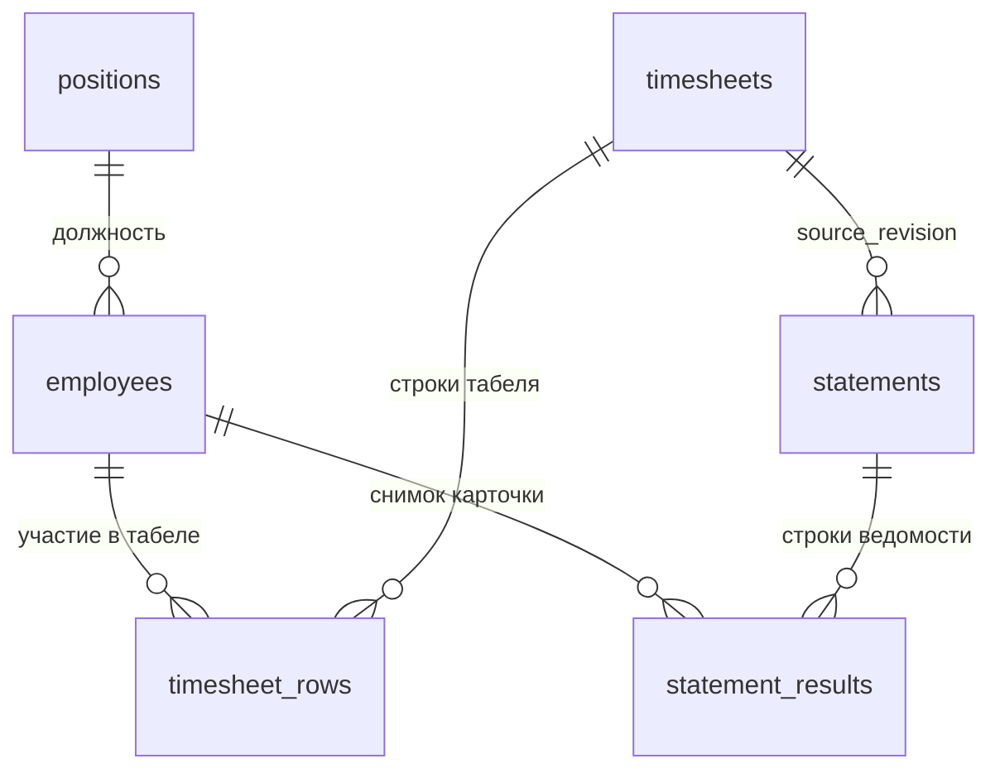

# ER-схема БД Salary Calculator (инженер 3)

Схема согласована с фактической миграцией
`alembic/versions/2026_11_17_b3d7f9a1c5e2_initial_schema.py`.

## Диаграмма

## Таблицы

| Таблица | Назначение | Ключи и ограничения |
| --- | --- | --- |
| `organization` | Реквизиты предприятия, всегда одна строка (id = 1) | PK `id`; CHECK форматов ИНН (10/12 цифр), КПП (9 цифр или NULL для ИП) |
| `positions` | Должности и тарифы | PK `name`; CHECK `base_rate > 0`, `seniority_percent` 0–100 |
| `employees` | Кадровые карточки | PK `employee_id` (Identity); UNIQUE `inn` (12 цифр); FK `position` → `positions.name` ON DELETE RESTRICT; CHECK стаж 0–80, ставка > 0, увольнение не раньше приёма |
| `calendar_norms` | Ручные нормы смен | UNIQUE `(year, month)`; CHECK год 1–9999, месяц 1–12, смены 1–31 |
| `timesheets` | Шапка месячного табеля | PK `timesheet_id`; UNIQUE `(year, month)`; CHECK норма 1–31, `revision >= 0` |
| `timesheet_rows` | Строки табеля участников | PK `(timesheet_id, employee_id)`; FK на табель CASCADE и на сотрудника RESTRICT; незаполненная строка — три NULL, CHECK «всё или ничего» и значения ≥ 0 |
| `statements` | Шапка ведомости | PK `statement_id`; UNIQUE `(year, month)`; `organization_name` — снимок названия; `source_revision` — версия табеля |
| `statement_results` | Строки ведомости | PK `(statement_id, employee_id)`; FK на ведомость CASCADE и сотрудника RESTRICT; **полный снимок** карточки сотрудника + дни и суммы в Numeric(12,2) |

## Принятые решения

1. Снимок сотрудника в `statement_results` дублируется полностью: правка
   карточки после расчёта не искажает историю ведомости.
2. Итоги ведомости не хранятся: `total_accrued`, `total_tax`, `total_to_pay`
   считаются из строк на лету (property доменной модели).
3. Удаление должности с сотрудниками блокирует RESTRICT; сотрудники
   не удаляются вовсе (только увольнение).
4. Незаполненная строка табеля — ряд с тремя NULL, а не нулевые смены.
5. Имена ограничений по конвенции `pk_/fk_/uq_/ck_` (см. `db/base.py`).
6. Деньги — `Numeric(12, 2)`, проценты — `Numeric(5, 2)`: без float.
7. Чтение табеля блокирует шапку (`SELECT ... FOR UPDATE`) — правки
   двух бухгалтеров не перетирают друг друга.
